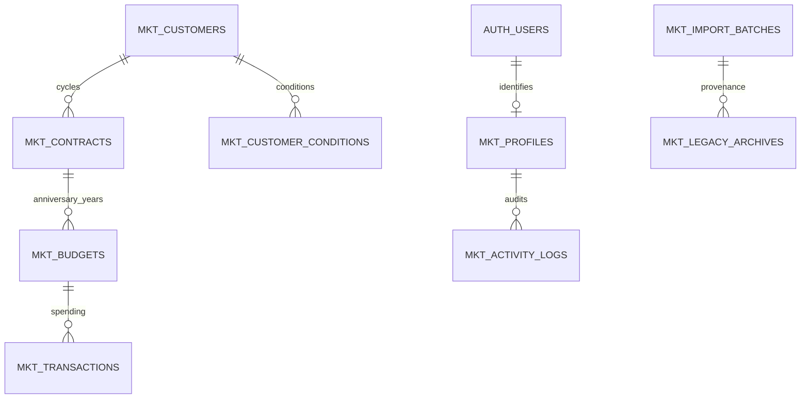

# FOC Support Phase 1 audit — REVIEW ONLY

Inspected default-branch commit `73d664de62bece11ff39cdf4fc1e2f09d5f036ac` on 2026-11-02. Work branch: `feature/supabase-phase1-schema-rls-review`. No hosted SQL, Auth provisioning, live import, GAS/Sheets mutation, main update, merge or deployment is authorized by this phase. The prepared migration is **NOT APPLIED to Supabase**.

## Actual architecture and evidence

- `package.json`, `package-lock.json`: React 19, TypeScript, Vite 8, Tailwind 4, motion, Recharts, XLSX; no Supabase client. `npm run lint` runs `tsc --noEmit`; tests are individual Node/tsx entrypoints, not `npm test`.
- `src/App.tsx`, `src/views/LoginView.tsx`, `src/services/storage.ts`: single storage service and username/password login. Production resolves the deployment-owned GAS endpoint in `src/config/backend.ts`; browser endpoint changes cannot replace it in production.
- `src/services/remoteAccounts.ts`: POST text/plain JSON `{action,payload,authToken}`; opaque GAS session in sessionStorage plus memory. `gas/Code.gs` hashes credentials and session tokens; `requireSession_` checks active status, expiry and password version against stored user rows. A browser role is not a valid future Supabase credential.
- `src/types/index.ts`: User/Customer/CustomerCondition/Contract/Budget/BudgetTransaction/ActivityLog/AppSettings are the source model inventory. Full field mapping below.
- `src/services/storage.ts`, `businessData.ts`, `businessWrites.ts`, `sheetPublish.ts`, `legacyRecovery.ts`: local snapshots, baseline fingerprint/revision, actor+endpoint outbox, pending full publish and browser recovery. The outbox operation ID is stable across retries. Preserve all these until reconciled; never clear browser storage to migrate.
- `src/services/sharedSettings.ts`: currency, price, alert threshold, language and five themes shared through Admin; backend routing is separate from shared presentation settings.
- `src/services/annualBudgets.js`, `tests/annual-budgets.test.ts`: contract-anniversary periods, Feb 29 clamp, inclusive expiry, separate usage per year and retained historical rows. Legacy undated usage is `unallocatedUsed` or residual `max(0,totalUsed - active dated transactions)`. Missing/ambiguous residuals require review, not a guessed import.
- `src/views/BudgetManagementView.tsx`, `src/services/storage.ts`, `gas/Code.gs` `buildBusinessWrite_`: current UPDATE_BUDGET is Admin-only and propagates to future stored years. The clarified requirement makes initial budget creation Admin-only and permits B1–B7 to edit only their own existing budgets. Proposed SAVE_BUDGET enforces this for each explicit annual period; future-year propagation remains a cutover decision. Existing app behavior is unchanged in this branch.
- `src/views/UploadExcelModal.tsx`, `src/services/storage.ts`: existing import defaults an annual budget and interprets fixed column positions; this is not evidence of an amount in the workbook. New migration must not infer money from quantity. Existing parser uses calendar dates and supports numeric serials; verify workbook date system independently.
- `src/views/AddTransactionModal.tsx`, `TransactionsView.tsx`, `ContractManagementView.tsx`, `CustomersView.tsx`, `UsersView.tsx`, `SettingsView.tsx`: spending/cancellation, renewal, customer CRUD, account and shared settings flows need adapter parity before cutover.
- `vite.config.ts`, `public/`, `.github/workflows/pages.yml`: relative-base PWA; Pages builds/deploys only on main push or explicit workflow dispatch. No workflow was triggered. `public/Code.gs` duplicates GAS source and downloadable sync material is public; no new private customer data or credentials may be put under public/.
- **Build trap:** `npm run build` removes `docs/` and copies dist there. This branch removes the obsolete docs-copy/delete step from `package.json` and allows only the Supabase Markdown review files through `.gitignore`. Pages already uploads dist, so the build output target stays unchanged. Both direct Vite and the updated `npm run build` are validated.

## Actual Sheets and auxiliary records

`gas/Code.gs` `SYNC_TABLES` defines CUSTOMERS, CUSTOMER_CONDITIONS, CONTRACTS, BUDGETS, BUDGET_TRANSACTIONS, ACTIVITY_LOG, SETTINGS. `userTables_` extends USERS with Status/Updated At/Deleted At; SESSIONS includes User ID and Password Version. `initializeDatabase` also creates CATEGORIES.

| Auxiliary source | Actual purpose | Proposed destination |
|---|---|---|
| MKT_MASTER | Legacy master/import source included in CORE_DATABASE_SHEETS_ | Validated normalized rows + redacted legacy archive |
| APP_WRITES | 9-column recoverable journal: operation/actor/request+plan hashes/state/chunk metadata/plan JSON/time | Reconcile pending jobs in GAS first; completed receipts mapped by controlled importer, no blindly replayed plan |
| BROWSER_RECOVERY | Chunked/checksummed browser snapshots, not authoritative current balances | Admin-only sanitized mkt_legacy_archives + encrypted source retained outside repo |
| CHANGE_HISTORY | Event/time/actor/action/table/record/operation/chunk/checksum/before-after JSON | Admin-only sanitized archive; new operations append mkt_activity_logs |
| DATABASE_BACKUPS | Daily/manual/delete backups; may include user hashes despite exclusion of sessions | Encrypted restricted source backup; strip credentials before any archive import |
| DELETED_CUSTOMERS | Code/date/actor/operation/backup registry blocking resurrection | mkt_deleted_customers tombstones; retained customer status/history |
| SESSIONS | GAS session digest, expiry, user/password version | Do not migrate; fresh Supabase Auth login |
| USERS password hash | GAS backend password credential | Do not migrate into public tables; approved reset/invite flow later |

At initial preparation only the master prompt was attached. During the 2026-11-02 follow-up the exact workbook was located and read privately: **578 rows and 578 unique customer codes** on Sheet1, with all eight required fields populated and no invalid team/date/quantity rows. See `docs/supabase-workbook-audit.md` for aggregate evidence. No private workbook or row values are committed. Monetary amounts and live Sheets reconciliation remain unverified. The preliminary SQL draft has not been read.

## Proposed relationships



Customer code and source IDs stay text. Composite FKs bind customer/team/contract/budget at every level; client team reassignment is denied even to Admin until a dedicated audited reassignment procedure exists. Parent deletes are restricted; customer deletion is a tombstone and soft status change, retaining all finances. PostgreSQL money uses numeric(18,2), quantity numeric(18,4); category is text to preserve legacy names, with a separate catalog.

The other proposed tables are mkt_settings, mkt_categories, mkt_deleted_customers, mkt_operation_receipts and mkt_import_batches. The invoker view mkt_budget_totals derives totals/status with scoped transaction reads. Legacy calculated totals are reconciliation evidence, not writable authoritative columns.

## Missing decisions / constraints

1. Workbook structural checks are complete; supply/identify the approved current monetary budget and transaction export from the correct GAS/Sheets database for private reconciliation. The preliminary SQL draft is optional and remains unreviewed; do not treat it as approved SQL.
2. Approve email/password enrollment or a rate-limited server-side username adapter; no fake email generation or public username-to-email directory is implemented.
3. Decide single-year budget edit vs propagating to future periods. This draft uses single-year edits, with version conflicts requiring reload.
4. Renewal and condition/price changes remain Admin-only, consistent with current backend. Teams can create customers, but an Admin creates their contract before they create annual budgets. Decide whether initial contract creation should be allowed for a team.
5. Amount reduction can show EXCEEDED against already-recorded spending; new spending is refused without a separately Admin-approved exception. No silent rewriting of old spending. Budget increases are allowed within own team per owner requirement.
6. Accounts/config/imports require a future privileged Admin backend; this phase intentionally grants no direct API writes to those tables. Account CRUD and bulk importer are not implemented here.
7. Contract dates are not editable by the RPC. Shortened legacy contracts with out-of-range retained historical budgets must be quarantined and explicitly reconciled; do not silently discard or force them past period constraints.
8. Currency is currently shared settings, not per-transaction FX accounting. Freeze currency during financial reconciliation or approve a multi-currency model before cutover.
9. This schema is repeatable against its exact empty/current shape; it does not reconcile arbitrary pre-existing mkt_* tables. Inspect catalog/diff first. Do not use IF NOT EXISTS to conceal incompatible old definitions.
10. No automatic auth signup trigger grants a role. Provision active profiles only through approved privileged account management.

## Migration order

Freeze writes in an approved maintenance window only after preserving each device's recovery/outbox; settle journal and revision conflicts; take verified private backups; stage and validate workbook+Sheets separately; reconcile financial totals by contract/year/team; apply reviewed schema in disposable staging; provision approved identities; import customers, conditions, contracts, budgets, transactions, tombstones, sanitized logs/archives/settings; compare all totals; rehearse rollback; only then request a separate cutover approval. See import plan and adapter plan.

## Field mapping

Every source field is listed below. Nullable source dates/actor references need staging validation, not fabricated defaults. Unknown extra Sheet columns must remain in a private source export and sanitized archive if appropriate; never discard them silently.

### User → mkt_profiles

| Source field | Destination / handling |
|---|---|
| id | id (new Auth UUID); source ID → legacy_id |
| username | username |
| password | EXCLUDED — reset/invite through Auth; never archive hash/plaintext |
| fullName | full_name |
| email | email |
| role | role |
| team | team |
| isActive | is_active |
| createdAt | created_at |
| lastLogin | last_login (Auth audit synchronization later) |
| status | status |
| updatedAt | updated_at |
| deletedAt | deleted_at |

### Customer → mkt_customers

| Source field | Destination / handling |
|---|---|
| code | code |
| name | name |
| team | team |
| mde | mde |
| phone | phone |
| address | address |
| province | province |
| contactPerson | contact_person |
| status | status |
| updatedAt | updated_at |
| deletedAt | deleted_at |
| createdAt | created_at |

### CustomerCondition → mkt_customer_conditions

| Source field | Destination / handling |
|---|---|
| id | id |
| customerCode | customer_code |
| conditionQuantity | condition_quantity |
| conditionUOM | condition_uom |
| conditionProductDescription | condition_product_description |
| pricePerUnit | price_per_unit |
| updatedAt | updated_at |

### Contract → mkt_contracts

| Source field | Destination / handling |
|---|---|
| id | id |
| customerCode | customer_code |
| customerName | legacy_customer_name (snapshot); live name via customer join |
| team | team |
| commencingOn | commencing_on |
| expiringOn | expiring_on |
| updatedAt | updated_at |
| cycleNumber | cycle_number |
| status | legacy_status (snapshot); current status derived from business date |
| notes | notes |
| createdAt | created_at |

### Budget → mkt_budgets

| Source field | Destination / handling |
|---|---|
| id | id |
| contractId | contract_id |
| customerCode | customer_code |
| team | team |
| annualAmount | annual_amount |
| unallocatedUsed | unallocated_used |
| periodNumber | period_number |
| periodStart | period_start |
| periodEnd | period_end |
| totalUsed | mkt_budget_totals.total_used (reconcile old value privately) |
| remainingAmount | mkt_budget_totals.remaining_amount (derived) |
| utilizationPercentage | mkt_budget_totals.utilization_percentage (derived) |
| status | mkt_budget_totals.status (derived) |
| allowException | allow_exception |
| exceptionReason | exception_reason |
| updatedAt | updated_at |

### BudgetTransaction → mkt_transactions

| Source field | Destination / handling |
|---|---|
| id | id |
| date | date |
| customerCode | customer_code |
| customerName | legacy_customer_name |
| team | team |
| contractId | contract_id |
| budgetId | budget_id |
| category | category |
| description | description |
| amount | amount |
| invoiceRef | invoice_ref |
| createdBy | created_by Auth UUID + legacy_created_by source text |
| createdAt | created_at |
| status | status |
| cancellationReason | cancellation_reason |
| cancelledBy | cancelled_by Auth UUID + legacy_cancelled_by source text |
| cancelledAt | cancelled_at |

### ActivityLog → mkt_activity_logs

| Source field | Destination / handling |
|---|---|
| id | id (source log text ID) |
| timestamp | timestamp |
| user | legacy_user; actor_id if verified mapping |
| role | role |
| team | team |
| action | action |
| details | details |

### AppSettings → mkt_settings

| Source field | Destination / handling |
|---|---|
| spreadsheetId | Private migration provenance/deployment configuration; not shared setting |
| appsScriptUrl | Deployment configuration; preserve GAS frontend unchanged |
| currencyCode | key `currencyCode` / validated JSON value (Admin configuration) |
| currencySymbol | key `currencySymbol` / validated JSON value (Admin configuration) |
| currencyPosition | key `currencyPosition` / validated JSON value (Admin configuration) |
| pricePerCrate | key `pricePerCrate` / validated JSON value (Admin configuration) |
| contractAlertDays | key `contractAlertDays` / validated JSON value (Admin configuration) |
| warningThresholdPercent | key `warningThresholdPercent` / validated JSON value (Admin configuration) |
| syncMode | Adapter/deployment mode; no public client override |
| language | key `language` / validated JSON value (Admin configuration) |
| dashboardTheme | key `dashboardTheme` / validated JSON value (Admin configuration) |

## Complete tracked source tree at audited commit

```text
.env.example
.github/workflows/pages.yml
.gitignore
README.md
THEME-UPDATE-README.md
bun.lock
gas/ADMIN-POLICY.md
gas/ANNUAL-BUDGETS.md
gas/AUTO-SAVE.md
gas/Code.gs
gas/CustomerImport.gs
gas/DATABASE-CONTINUITY.md
gas/DatabaseSetup.gs
gas/READ-FROM-SHEETS.md
gas/README.md
gas/SYNC-SETUP.md
gas/USER-ACCOUNTS.md
index.html
metadata.json
package-lock.json
package.json
public/ADMIN-POLICY.md
public/ANNUAL-BUDGETS.md
public/AUTO-SAVE.md
public/Code.gs
public/DATABASE-CONTINUITY.md
public/MKT-Sheets-Sync.zip
public/READ-FROM-SHEETS.md
public/SYNC-SETUP.md
public/USER-ACCOUNTS.md
public/apple-touch-icon.png
public/favicon.ico
public/icon.svg
public/pwa-192x192.png
public/pwa-512x512.png
public/pwa-maskable-512x512.png
src/App.tsx
src/components/AppUpdateNotice.tsx
src/components/EditPricePerCrateModal.tsx
src/components/EditProfileModal.tsx
src/components/ErrorBoundary.tsx
src/components/Header.tsx
src/components/OfflineIndicator.tsx
src/components/PWAInstallButton.tsx
src/components/SheetDataNotice.tsx
src/components/Sidebar.tsx
src/components/ThemeSwitcher.tsx
src/config/backend.ts
src/data/seedData.ts
src/hooks/useOnlineStatus.ts
src/hooks/usePWAInstall.ts
src/index.css
src/locales/translations.ts
src/main.tsx
src/services/annualBudgets.js
src/services/appUpdates.ts
src/services/businessData.ts
src/services/businessWrites.ts
src/services/gasService.ts
src/services/legacyRecovery.ts
src/services/remoteAccounts.ts
src/services/sharedSettings.ts
src/services/sheetAutoRefresh.ts
src/services/sheetPublish.ts
src/services/storage.ts
src/types/index.ts
src/views/AddContractModal.tsx
src/views/AddCustomerModal.tsx
src/views/AddTransactionModal.tsx
src/views/BudgetManagementView.tsx
src/views/ContractManagementView.tsx
src/views/CustomerDetailModal.tsx
src/views/CustomersView.tsx
src/views/DashboardView.tsx
src/views/DeleteAllCustomersModal.tsx
src/views/GasDocsModal.tsx
src/views/LoginView.tsx
src/views/ReportsView.tsx
src/views/SettingsView.tsx
src/views/TransactionsView.tsx
src/views/UploadExcelModal.tsx
src/views/UsersView.tsx
tests/admin-policy.test.ts
tests/annual-budgets.test.ts
tests/app-updates.test.ts
tests/business-writes.test.ts
tests/customer-delete.test.ts
tests/deployment-backend.test.ts
tests/deployment-write-migration.test.ts
tests/excel-calendar-date.test.ts
tests/gas-service.test.ts
tests/gas-sync.test.cjs
tests/legacy-recovery.test.ts
tests/remote-accounts.test.ts
tests/sheet-auto-refresh.test.ts
tests/sheet-business-read.test.ts
tests/sheet-publish.test.ts
tsconfig.json
vite.config.ts
```
